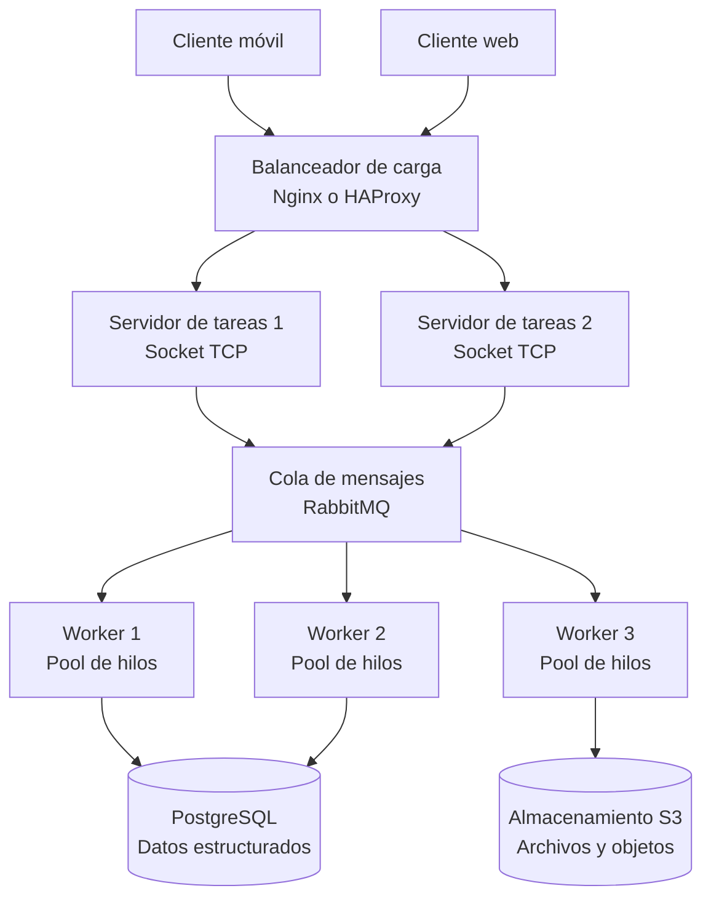

# Diagrama de arquitectura distribuida

El siguiente diagrama representa la arquitectura propuesta. El código Python implementa los sockets TCP y el pool de hilos; Nginx, RabbitMQ, PostgreSQL y S3 se incluyen como componentes de la arquitectura objetivo y no requieren instalación para ejecutar la demostración local.

## Descripción de los componentes

- **Clientes web y móviles:** solicitan tareas al sistema.
- **Balanceador Nginx/HAProxy:** distribuye las solicitudes entre distintos servidores para evitar que toda la carga recaiga en uno solo.
- **Servidores de tareas:** reciben solicitudes y las derivan para su procesamiento.
- **Workers y pool de hilos:** ejecutan las tareas concurrentemente.
- **RabbitMQ:** permite encolar mensajes y desacoplar a los servidores de los workers.
- **PostgreSQL:** guarda información estructurada.
- **S3:** almacena archivos u objetos.

**Alcance de la implementación:** para mantener el ejercicio simple y ejecutable en una computadora, la versión entregada utiliza un servidor TCP, varios hilos para atender conexiones y un `ThreadPoolExecutor` para procesar tareas. Los componentes externos se muestran en el diagrama como una posible ampliación; no se afirma que estén conectados al código de demostración.
